<div align="center">

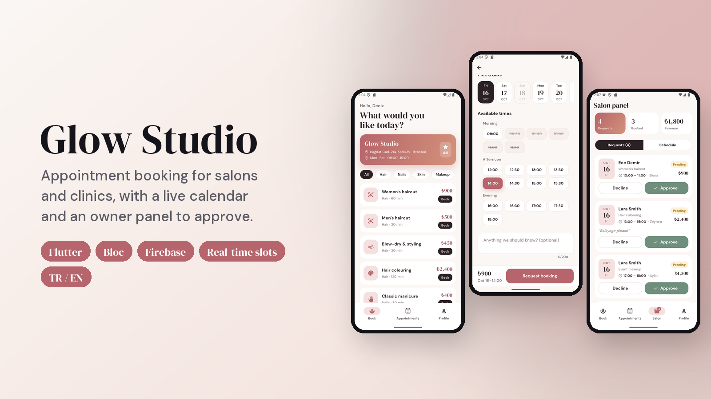

# Glow Studio · Flutter Randevu Uygulaması

Kuaför, berber, klinik ve stüdyolar için bir randevu uygulaması:
- Müşteri hizmeti, uzmanı ve canlı takvimden boş bir saati seçer.
- İşletme sahibi talepleri yönetici panelinden onaylar ya da reddeder.
- Çift rezervasyon imkânsız; bunu yalnızca arayüz değil, veritabanı da garanti eder.

[](https://flutter.dev)
[](https://bloclibrary.dev)
[](https://firebase.google.com)
[](https://github.com/SafaSenturk/flutter-booking-app/actions/workflows/ci.yml)
[](LICENSE)

**[⬇️ APK'yı indir](https://github.com/SafaSenturk/flutter-booking-app/releases/latest)** · [🇬🇧 English](#-english)

</div>

---

## Demo

<p align="center">
  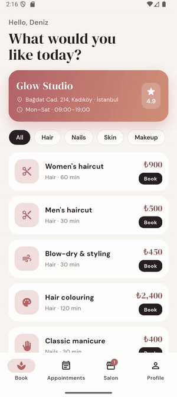
</p>

<p align="center"><i>Hizmet seç → uzman → gün → boş saat → talep gönder → salon onaylar → müşteriye bildirim gider.</i></p>

## Özellikler

**Müşteri tarafı**
- Süre ve fiyatıyla kategorili hizmet menüsü; ekip ve puanları.
- **Uzman seçimi** ya da "fark etmez" (ilk müsait uzman atanır).
- Önümüzdeki 30 gün için **tarih şeridi**; kapalı günler (pazar) soluk görünür.
- **Canlı müsaitlik:**
  - Boş saatler çalışma saatleri, hizmet süresi ve mevcut randevulara göre hesaplanır.
  - Liste gerçek zamanlı güncellenir; sen bakarken biri saati alırsa o saat listeden kaybolur.
- Salona isteğe bağlı not, animasyonlu onayla randevu talebi.
- **Randevularım:**
  - Yaklaşan ve geçmiş randevular.
  - Durumlar: beklemede, onaylandı, reddedildi, iptal edildi, tamamlandı.
  - **2 saat öncesine kadar iptal**.
- Salon onaylayınca ya da reddedince **bildirim**.

**İşletme sahibi tarafı**
- Onayla / Reddet düğmeli **talepler**; sekmede canlı rozet.
- Tüm çalışanları gösteren **günlük takvim**; ziyaretten sonra "tamamlandı" işaretleme.
- Günün özeti: talepler, onaylı randevular, beklenen ciro.

**İşletme tarafını kendin dene:** *Profil*'de **"Salon panelini dene"** seçeneğini aç. Böylece **kendi** randevularını işletme sahibiymiş gibi yönetirsin. Diğer müşterilerin verilerini asla göremezsin; bunu güvenlik kuralları sağlar.

**Genel**
- E-posta/şifre ve Google ile giriş, şifre sıfırlama.
- Türkçe / İngilizce.
- Randevuyla çalışan her işletmeye uyar: kuaför, berber, güzellik ve tırnak stüdyosu, klinik, fizyoterapist, özel ders, danışmanlık…

## Ekran görüntüleri

| Giriş | Hizmetler | Uzman ve tarih | Canlı saatler |
|:---:|:---:|:---:|:---:|
| 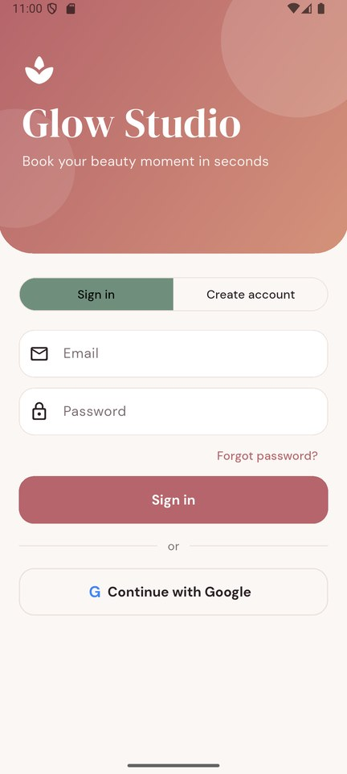 | 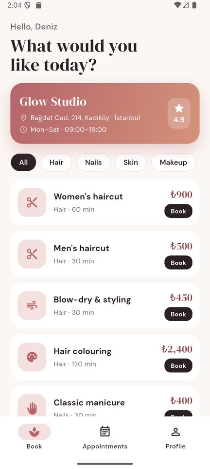 | 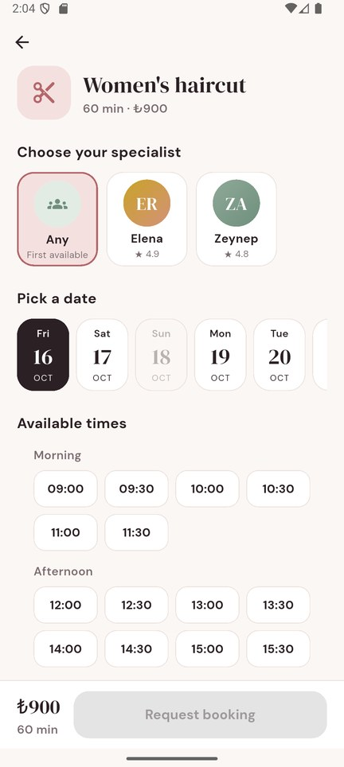 | 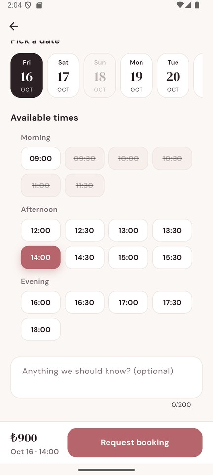 |
| **Talep gönderildi** | **Randevularım** | **Sahip: talepler** | **Sahip: takvim** |
| 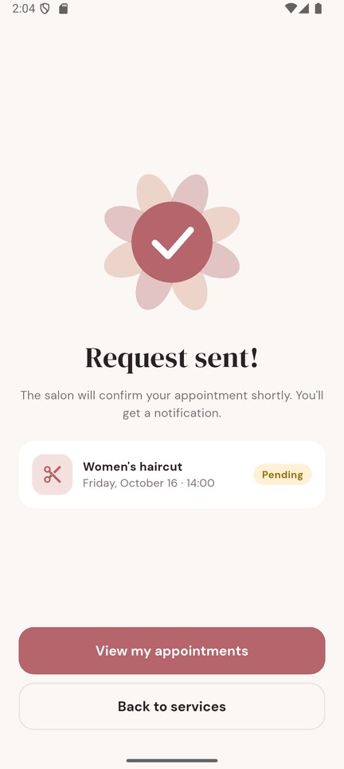 | 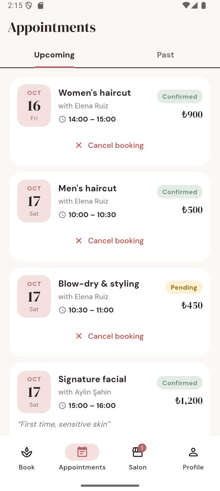 | 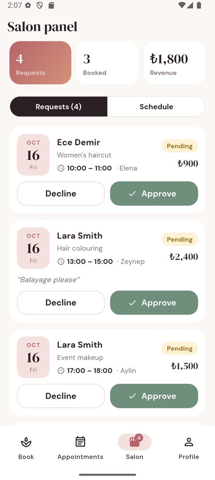 | 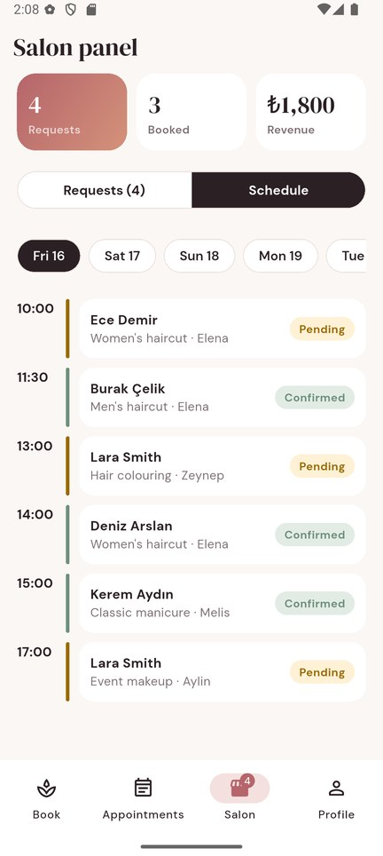 |
| **Demo sahip modu** | **Profil** | **Türkçe** | **Türkçe** |
| 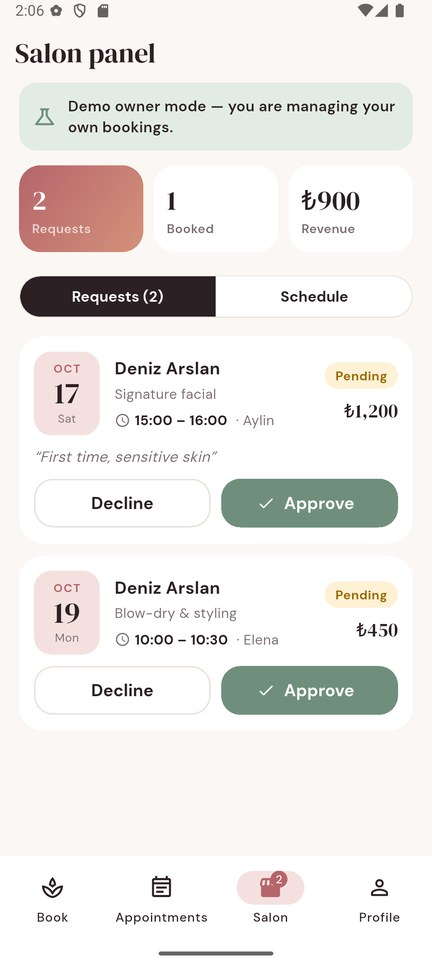 | 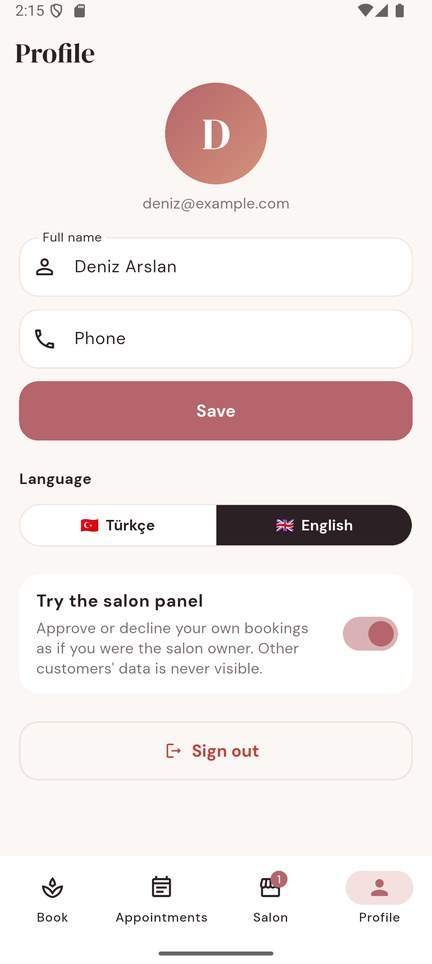 | 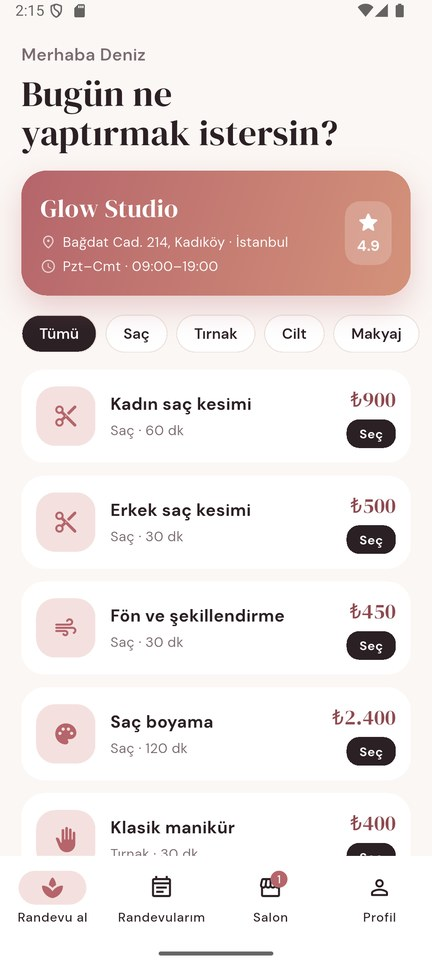 | 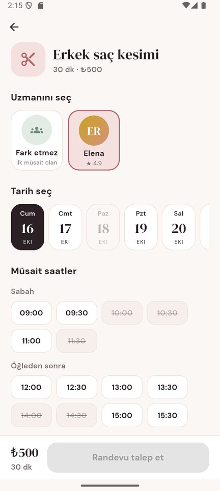 |

## Çift rezervasyon nasıl engelleniyor?

- **Dilimler ayrı belge:** her dolu 30 dakikalık dilim bir belgedir: `slots/{staff}_{yyyyMMdd}_{HHmm}`.
- **Transaction:** rezervasyon bir **Firestore transaction'ı** içinde yapılır. Hizmetin kapsadığı her dilim kontrol edilir; randevu ve dilimleri birlikte yazılır.
- **Güvenlik kuralları:**
  - Dilim yalnızca *oluşturulabilir*, hiçbir zaman üzerine yazılamaz.
  - Dilim id'si çalışan, gün ve saatle eşleşmek zorundadır.
  - Dilimin aynı kullanıcının bir randevusuna ait olduğu kontrol edilir.
- Sonuç: değiştirilmiş bir istemci bile aynı saati iki kez alamaz ya da başkası adına randevu oluşturamaz.

```
users/{uid}          name, email, phone, role (customer | admin), demoOwner
services/{id}        nameEn, nameTr, category, durationMin, price      ← uygulamada salt okunur
staff/{id}           name, roleEn, roleTr, rating, services[]          ← uygulamada salt okunur
appointments/{id}    uid, serviceId, staffId, start, durationMin, price,
                     status (pending → confirmed / declined / cancelled → completed), note, slotIds[]
slots/{staff_day_time}  uid, appointmentId
```

| Kim | Neler yapabilir |
|---|---|
| Müşteri | kendi *beklemede* randevusunu oluşturur, kendi randevularını okur, yaklaşan randevularını iptal eder |
| Sahip (`role: admin`) | tüm randevuları okur; onaylar / reddeder / tamamlar; dilimleri boşaltır |
| Demo sahip modundaki müşteri | sahip işlemlerini yalnızca kendi randevuları üzerinde yapar |
| Uygulamadaki hiç kimse | rolünü değiştiremez, kataloğu düzenleyemez |

Bu kurallar **Firebase Emulator üzerinde 13 testle** doğrulanır ([`rules-tests/`](rules-tests/rules.test.js)).

## Teknolojiler

| Alan | Seçim |
|---|---|
| Uygulama | Flutter 3.44, Material 3, serif/sans özel tasarım (DM Serif Display + DM Sans) |
| State management | **flutter_bloc 9**: her özellik için Cubit'ler, `bloc_test` + `mocktail` |
| Arka uç | Firebase Auth (e-posta, Google), Cloud Firestore (transaction'lar, gerçek zamanlı sorgular), güvenlik kuralları |
| Bildirimler | Randevu durumu değişince `flutter_local_notifications` |
| Yerelleştirme | ARB + `gen-l10n`, Türkçe ve İngilizce |
| CI | GitHub Actions: analyze, birim/bloc testleri, güvenlik kuralı testleri |

## Proje yapısı

```
lib/
├── main.dart                   # Firebase, repository'ler, genel cubit'ler
├── core/                       # tema, biçimleme, ortak widget'lar, bildirimler
├── data/                       # modeller, Auth / Catalog / Booking repository'leri
├── domain/availability.dart    # saf dilim mantığı (çalışma saatleri, ön süre, çakışmalar)
├── features/
│   ├── auth/                   # AuthCubit + giriş / kayıt
│   ├── catalog/                # hizmetler ve ekip
│   ├── booking/                # BookingCubit, randevu akışı, onay
│   ├── appointments/           # randevularım, iptal
│   ├── admin/                  # sahip paneli: talepler ve takvim
│   ├── profile/                # profil, dil, demo sahip modu
│   └── home/                   # alt gezinme kabuğu
└── l10n/
tool/seed_catalog.py            # hizmetleri ve ekibi yükler
rules-tests/                    # Firestore kural testleri (emülatör)
firestore.rules · firestore.indexes.json
```

## Kendin çalıştır

```bash
git clone https://github.com/SafaSenturk/flutter-booking-app.git
cd flutter-booking-app
flutter pub get
flutter run
```

```bash
flutter test                          # müsaitlik mantığı + cubit'ler (13 test)
cd rules-tests && npm ci && npm test  # emülatörde güvenlik kuralları (Java gerekir)
```

Kendi Firebase projeni kullanmak için:
1. E-posta/Şifre ve Google girişini aç.
2. `flutterfire configure` çalıştır.
3. `firebase deploy --only firestore` çalıştır.
4. `python tool/seed_catalog.py <proje-id>` çalıştır.
5. Bir hesabı işletme sahibi yapmak için konsolda o hesabın `users` belgesine `role: "admin"` yaz.

**Denemek için:** [Releases](https://github.com/SafaSenturk/flutter-booking-app/releases/latest) sayfasından APK'yı indir, hesap oluştur ve randevu al. Sonra *Profil → "Salon panelini dene"* ile kendi randevularını işletme sahibi gibi onaylayabilirsin.

İşletmen için kendi markanla bir randevu uygulaması mı istiyorsun? **[safasenturk.github.io](https://safasenturk.github.io)**

### 🧩 Bu projeden çıkan eklentiler

Bu uygulamadaki şu parçaları başka projelerde de kullanılabilsin diye **[Plugins](https://github.com/SafaSenturk/Plugins)** reposuna ekledim. Oradan erişip kendi projene kopyalayabilirsin:

- **[booking-slots](https://github.com/SafaSenturk/Plugins/tree/main/booking-slots)**: müsaitlik hesabı, çift rezervasyonu engelleyen transaction ve güvenlik kuralları.

---

## 🇬🇧 English

**Glow Studio** is a booking app for salons, barbers, clinics and studios:
- Customers pick a service, a specialist and a free time on a live calendar.
- The owner approves or declines requests from an admin panel.
- Double bookings are impossible: the database enforces it, not just the UI.

The demo, screenshots, data model and project structure are shown above. **[⬇️ Download the APK](https://github.com/SafaSenturk/flutter-booking-app/releases/latest)**

### Features

**For customers**
- Service menu by category with duration and price, plus the team with ratings.
- **Choose a specialist** or "any" (the first one who is free is assigned).
- **Date strip** for the next 30 days; closed days (Sunday) are greyed out.
- **Live availability:**
  - Time slots are calculated from opening hours, service length and existing bookings.
  - Slots update in real time: if someone takes your slot while you look, it disappears.
- Optional note for the salon, booking request with an animated confirmation.
- **My appointments:**
  - Upcoming and past bookings.
  - Status: pending, confirmed, declined, cancelled, completed.
  - **Cancel up to 2 hours before**.
- **Notification** when the salon confirms or declines.

**For the salon owner**
- **Requests** with Approve / Decline, live badge on the tab.
- **Daily schedule** timeline across all staff, "mark done" after the visit.
- Today's stats: requests, confirmed bookings, expected revenue.

**Try the owner side yourself:** in *Profile*, switch on **"Try the salon panel"**. You then manage **your own** bookings as if you were the owner. Other customers' data is never visible; the security rules enforce this.

**General**
- Email/password and Google sign-in, password reset.
- Turkish / English.
- Works for any business with appointments: hairdressers, barbers, beauty and nail studios, clinics, physiotherapists, tutors, consultants…

### How double booking is prevented

- **One document per slot:** each booked 30-minute block is a document `slots/{staff}_{yyyyMMdd}_{HHmm}`.
- **Transaction:** booking runs in a **Firestore transaction** that checks every block of the service, then writes the appointment and its slots together.
- **Security rules:**
  - A slot can only be *created*, never overwritten.
  - The slot id must match its staff, day and time.
  - The slot must belong to an appointment of the same user.
- So even a modified client cannot double-book or book for someone else.

| Who | Can do |
|---|---|
| Customer | create own *pending* bookings, read own bookings, cancel own upcoming ones |
| Owner (`role: admin`) | read all bookings, confirm / decline / complete, free slots |
| Customer in demo owner mode | the owner actions, on their own bookings only |
| Nobody in the app | change their role, edit the catalog |

These rules are covered by **13 tests on the Firebase Emulator** ([`rules-tests/`](rules-tests/rules.test.js)).

### Tech stack

| Area | Choice |
|---|---|
| App | Flutter 3.44, Material 3, custom serif/sans design (DM Serif Display + DM Sans) |
| State management | **flutter_bloc 9**: Cubits per feature, `bloc_test` + `mocktail` |
| Backend | Firebase Auth (email, Google), Cloud Firestore (transactions, real-time queries), security rules |
| Notifications | `flutter_local_notifications` on booking status changes |
| Localization | ARB + `gen-l10n`, Turkish & English |
| CI | GitHub Actions: analyze, unit/bloc tests, security-rule tests |

### Run it yourself

```bash
git clone https://github.com/SafaSenturk/flutter-booking-app.git
cd flutter-booking-app
flutter pub get
flutter run
flutter test      # availability logic + cubits (13 tests)
```

To use your own Firebase project:
1. Enable Email/Password and Google sign-in.
2. Run `flutterfire configure`.
3. Run `firebase deploy --only firestore`.
4. Run `python tool/seed_catalog.py <project-id>`.
5. To make an account the owner, set `role: "admin"` on its `users` document in the console.

Want a booking app for your business, with your own brand? **[safasenturk.github.io](https://safasenturk.github.io)**

### 🧩 Reusable plugins from this app

These parts of the app are available in the **[Plugins](https://github.com/SafaSenturk/Plugins)** repo, ready to copy into your own project:

- **[booking-slots](https://github.com/SafaSenturk/Plugins/tree/main/booking-slots)**: availability logic, the transaction that prevents double bookings and the security rules.

---

<div align="center">

**[Safa Şentürk](https://github.com/SafaSenturk)** · Flutter Mobil Geliştirici · Flutter Mobile Developer · [Portföy / Portfolio](https://safasenturk.github.io)

<sub>Glow Studio, ekibi ve adresi hayalîdir; yalnızca tanıtım amaçlıdır. · Glow Studio, its team and address are fictional and used for demonstration only.</sub>

</div>
